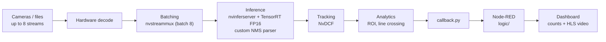
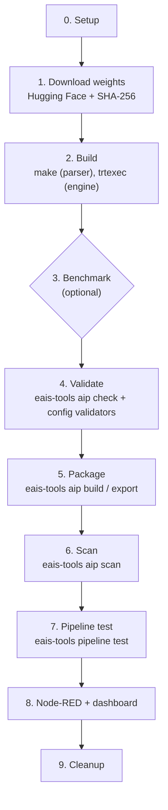

# AIPV1EMI0001 — YOLOv7 Tiny AiProcessor


An [EdgeAI Station](https://edgematrix.com) AiProcessor (AIP) providing general-purpose object detection using a reparameterized [YOLOv7-tiny](https://github.com/WongKinYiu/yolov7) model, running on NVIDIA DeepStream with Triton Inference Server.

## What it does

Detects 3 generic object classes in video streams:

- `car`
- `person`
- `truck`

Tracking is handled by the NVIDIA NvDCF multi-object tracker. The AIP supports the `ROI` (region of interest) and `LCC` (line crossing counter) analytic plugins, and up to 8 input streams.

## Repository layout

| Path | Description |
|---|---|
| `manifest.json` | AIP descriptor (ID, version, hardware targets, processors, analytics) |
| `store.json` | EdgeAI Store listing metadata |
| `callback.py` | User callback — transforms DeepStream batch metadata into AIP metadata |
| `logic/` | Importable Node-RED project: callback subscription and count normalization |
| `dashboard/` | Offline Vue 3 UIBuilder SPA with HLS, class, ROI and line-crossing views |
| `configs/` | DeepStream inference config (`nvinferserver` / Triton) and NvDCF tracker config |
| `models/AIPV1EMI0001_Yolo_Detector/` | Triton model repository: `config.pbtxt`, labels. Model weights are **not** stored here — they are downloaded from Hugging Face (see below) |
| `src/nvdsinfer_customparser/` | Custom bounding-box parser plugin (`libnvds_infercustomparser.so`) for `nvinfer` |
| `bin/build.sh` | Builds the custom parser plugin and the TensorRT engine with `trtexec` |
| `localdev.ipynb` | Step-by-step build notebook: download weights → build → optional benchmark → validate → package → scan → pipeline test → dashboard |
| `presentation.ipynb` | Talk companion: AI Processor concepts, pipeline diagrams and benchmark results |
| `tools/` | Notebook and CI helpers: `check_package.py` (exact package contents) and `benchmark.py` (fair ONNX Runtime/TensorRT benchmark) |
| `doc/` | User manual and integration notes |
| `doc/benchmarks/` | Reference benchmark results (JSON) and chart |
| `tests/` | Offline tests for the notebook, tools and dashboard |
| `.github/workflows/release.yml` | CI: on `v*` tag, packages the AIP archive and publishes a GitHub release |

## Requirements

- EdgeAI Station (EX3 / EX5 / EX7 hardware targets) or a Jetson host (Jetson only — x86 NVIDIA GPU hosts are not supported) with:
  - DeepStream 7.0+
  - TensorRT (`trtexec`)
  - CUDA toolkit (to build the custom parser plugin)

## Model weights

The trained weights are not stored in this repository. They are published on Hugging Face at
[`Edgematrix-JP/AIPV1EMI0001`](https://huggingface.co/Edgematrix-JP/AIPV1EMI0001):

| File | Description |
|---|---|
| `yolov7tiny-640.onnx` | **Primary artifact** — ONNX export with `EfficientNMS_TRT`, input for the engine build |
| `yolov7-fp16-1x8x8-jp6-l4t36.3-arm64.engine` | Prebuilt TensorRT FP16 engine (JetPack 6 / L4T R36.3 / aarch64 only) |
| `SHA256SUMS` | Checksums for download verification |

The weights are licensed under **GPL-3.0**, matching the upstream YOLOv7 training code.

The `localdev.ipynb` notebook downloads the ONNX and verifies it automatically.

## How it works



Frames stay in GPU memory from decode to analytics; only metadata reaches Python.
`nvinferserver` runs the Triton runtime **inside** the DeepStream process, with no network
hop to a separate model server.

## Build, package & deploy

[`localdev.ipynb`](localdev.ipynb) rebuilds the AIP step by step. Each cell is one visible
command, mostly `eais-tools`, `trtexec` and `make`, or a short inline check. A failing
command stops the notebook.



Run it in the station's Jupyter environment (App-Builder) from a clone at
`/data/aip/AIPV1EMI0001`:

```bash
cd /data/aip && git clone https://github.com/edge-ai/AIPV1EMI0001.git
```

Options:

- Step 0, `ENGINE_SOURCE = "build"` compiles the FP16 engine from the ONNX with `trtexec`.
  Allow 30–60 minutes on a busy Orin NX. `"prebuilt"` downloads the engine from Hugging Face
  instead (JetPack 6 / L4T R36.3 / TensorRT 8.6.2 only).
- Step 0, `RUN_BENCHMARKS = True` enables section 3. It is off by default.
- Step 8, `NR_PROJECT`: use a new name on a station that already has the default Node-RED
  project. The cell refuses to overwrite an existing project unless `OVERWRITE=1`.

The pipeline test and dashboard are wired to a temporary `eais_*` pipeline, which step 9
deletes. Repoint `AIP_PIPELINE_ID` to a permanent pipeline afterwards. Cleanup keeps
`dist/` and the exported archive.

The notebook was executed top to bottom with both engine options on a Jetson Orin NX 16 GB
(JetPack 6.0 / L4T R36.3, TensorRT 8.6.2, DeepStream 7.0, `eais-tools` 0.9.2), with the
benchmark disabled. Activating and viewing the dashboard remains a manual step.

**Packaging safeguards.** EAIS Tools 0.9.2 does not honor `.gitignore` or `!` exclusion
rules, and copies whole directories. [`.include`](.include) therefore lists individual files,
and the notebook passes it explicitly to `eais-tools aip build`.
[`tools/check_package.py`](tools/check_package.py) then requires the exact intended file set
in `dist/`, and checks that the exported archive matches `dist/` file by file (SHA-256).
Unexpected files cause a failure, not silent removal.

**Configuration validation.** Step 4 runs `eais-tools aip check`, then calls the EAIS Triton
and DeepStream validators directly on the deployment configs, plus tracker YAML and library
path checks. (`eais-tools configs triton check` and `configs ds check` start a blocking
server, and the latter does not exercise `nvtracker`.)

**Runtime acceptance.** Step 7 runs `eais-tools pipeline test` on the station-managed
pipeline (inference, NvDCF tracker and callback, display output disabled). It requires
detected objects and valid callback metadata, not merely a start response. Before testing
and cleanup, the notebook checks that no other run owns existing `eais_*` resources, since
`eais-tools pipeline clean` deletes all of them.

### Comparable ONNX/TensorRT measurements

Section 3 of the notebook runs [`tools/benchmark.py`](tools/benchmark.py). It compares direct
ONNX Runtime CUDA FP32 inference with TensorRT FP32 (`--noTF32`) and FP16 engines **using one
timing boundary for every backend**.

[NVIDIA's timing definitions](https://docs.nvidia.com/deeplearning/tensorrt/archives/tensorrt-861/developer-guide/index.html#trtexec)
show why `trtexec` cannot simply be placed next to a Python ONNX Runtime loop: its GPU
Compute Time excludes host dispatch, its Host Latency sums transfer and GPU times, and it
pipelines submissions. The harness therefore follows Ultralytics's normal prediction path:
[its inference-only timing block](https://github.com/ultralytics/ultralytics/blob/80c34c050921abd29970d8e3d2a2a41ec6538c98/ultralytics/engine/predictor.py#L380-L397)
uses [the same synchronized wall-clock profiler](https://github.com/ultralytics/ultralytics/blob/80c34c050921abd29970d8e3d2a2a41ec6538c98/ultralytics/utils/ops.py#L20-L76)
around each backend. (Its separate
[`ProfileModels.profile_onnx_model`](https://github.com/ultralytics/ultralytics/blob/80c34c050921abd29970d8e3d2a2a41ec6538c98/ultralytics/utils/benchmarks.py#L512-L585)
runs ONNX on CPU, so it is not a GPU-to-GPU reference.)

In one Python process:

- All variants run the same NMS-free graph. The deployment graph keeps NMS.
- ONNX Runtime uses only `CUDAExecutionProvider` with `use_tf32=0`, matching the
  engines' `--noTF32`; TensorRT FP16 is built with `--fp16 --noTF32`.
- `trtexec` only builds the engines. The **actual `.engine` files** are executed by
  TensorRT's Python runtime (`execute_async_v3`). ONNX Runtime's TensorRT provider is not
  used: it would build its own engine instead of measuring the supplied one.
- All variants read the same GPU input buffer and write preallocated GPU outputs.
- Per request: `cudaDeviceSynchronize` → `perf_counter_ns` → one call →
  `cudaDeviceSynchronize`. 20 warm-up and 50 timed requests per round, 3 rounds, with
  backend order shuffled each round.
- Results: median, p95 and mean latency, ms/image, serial images/s and speed-up versus
  ONNX Runtime at the same batch. Outputs are compared after timing. GPU load/frequency
  and software versions are recorded; clocks and power mode are not changed.

MS8 has the TensorRT 8.6.2.3 libraries but no TensorRT Python bindings. The harness does
not install anything system-wide: it downloads `python3-libnvinfer` at exactly the installed
`libnvinfer8` version from the configured NVIDIA Jetson APT repository, checks its hash and
exact dependencies, and extracts it under `tmp/`. A current PyPI `tensorrt` wheel would not
match the station. Models, logs and results stay under `tmp/inference-benchmark/`, outside
the AIP package. The benchmark does not use a model server or restart station services.

Reference run (Orin NX 16 GB, L4T R36.3, TensorRT 8.6.2, ONNX Runtime 1.19.0; median
per-request latency, speed-up versus ONNX Runtime). Full results:
[`doc/benchmarks/orin-nx-16gb-jp6.0.json`](doc/benchmarks/orin-nx-16gb-jp6.0.json),
chart: [`doc/benchmarks/orin-nx-16gb-jp6.0.png`](doc/benchmarks/orin-nx-16gb-jp6.0.png).

| Batch | ONNX Runtime CUDA FP32 | TensorRT FP32 | TensorRT FP16 |
|---|---|---|---|
| 1 | 49.8 ms | 38.7 ms (1.29×) | 12.0 ms (4.15×) |
| 4 | 181.9 ms | 125.7 ms (1.45×) | 34.6 ms (5.26×) |
| 8 | 317.3 ms | 244.5 ms (1.30×) | 63.3 ms (5.01×) |

The station was running its normal workload (GPU load 55–90 %, clock 918 MHz), so
absolute times are higher than on an idle device; compare ratios, and re-run for
your own station. TensorRT FP32 matched ONNX Runtime closely (max raw score difference
≈ 3×10⁻⁷). FP16 raw scores differed by at most 4×10⁻⁴; some raw box coordinates moved
by up to 14 px. The input is random, so this is a numerical sanity check, not an
accuracy evaluation.

### Release CI

The tag-triggered release workflow compiles the ARM64 parser in a pinned public DeepStream
7.0 SDK image, adds the checksum-verified prebuilt engine, and exports an archive with a
`dist/` root, matching `eais-tools aip export`. This image lacks EAIS Tools, so CI assembles
`dist/` from the explicit `.include` files and checks the result and the archive with the
same `tools/check_package.py`. The notebook remains the workflow that runs EAIS
validation, build and export. A manual workflow run validates packaging and saves an Actions
artifact without publishing a release.

## Presentation notebook

[`presentation.ipynb`](presentation.ipynb) is the companion to the talk *From Model to Field:
Engineering Reliable Edge AI Applications on Embedded GPUs*. It explains the AI Processor
contract, the GPU pipeline, the ONNX-to-TensorRT path, fair measurement, reproducible
packaging and layered validation, with diagrams and the benchmark chart above. Its live cells
are disabled by default.

## Integrated Node-RED dashboard

The AIP package includes a Node-RED project under [`logic/`](logic/) and its
UIBuilder application under [`dashboard/`](dashboard/). Together they provide:

- live HLS playback from `/ms3/pipeline/<pipeline-id>/hls`;
- per-class counts for `car`, `person`, and `truck`;
- per-source filtering;
- ROI and line-crossing counters when those analytics are configured.

Step 8 of [`localdev.ipynb`](localdev.ipynb) installs it as the Node-RED project
`nodered-aipv1emi0001-dashboard`, wired to a pipeline. To install it by hand:
copy `logic/` to a new project under the Node-RED projects directory, copy the
contents of `dashboard/` into that project's `uibuilder/` directory and run
`npm ci --omit=dev` there, then set `AIP_PIPELINE_ID` in the **AIPV1EMI0001
Logic** tab's Environment properties and deploy. The Node-RED nodes
(`@edge-ai/node-red-contrib-eais`, `node-red-contrib-uibuilder`) are
preinstalled on EdgeAI Stations. Open the dashboard at
`https://<station>/ms5/aipv1emi0001_dash/` and assign `aipv1emi0001_dash` to
users from Accounts management.

`flows_cred.json` is deliberately not distributed. If the project needs
credentials, configure Node-RED's `credentialSecret` through the station's
deployment environment, then let Node-RED generate the local credential file.
Never commit or redistribute that file.

The callback payload itself remains the source contract. Enable the flow's
disabled **inspect complete callback msg** debug node after MS3 or callback-node
upgrades and compare the live message with [`doc/USER_MANUAL.md`](doc/USER_MANUAL.md).

## Attribution

The model architecture is **YOLOv7** by WongKinYiu et al.:

> Chien-Yao Wang, Alexey Bochkovskiy, Hong-Yuan Mark Liao.
> *"YOLOv7: Trainable bag-of-freebies sets new state-of-the-art for real-time object detectors."*
> CVPR 2023. <https://github.com/WongKinYiu/yolov7> — GPL-3.0 License.

This is a general-purpose YOLOv7-tiny integration adapted by EdgeMatrix for EdgeAI Station,
exposing `car`, `person` and `truck`. It is not a parking-lot-specific model.
The exact upstream checkpoint provenance of the published export is not documented here.

## Contributors

This AI Processor was originally developed at EdgeMatrix by:

- [@antowan](https://github.com/antowan)
- [@aohta-emi](https://github.com/aohta-emi)
- [@yosukehara](https://github.com/yosukehara)

## License

- **Source code** in this repository: Apache-2.0 — see [LICENSE](LICENSE). It contains no
  YOLOv7 source code.
- **Model weights** (ONNX and TensorRT engines on Hugging Face, and the engine inside the packaged
  AIP): GPL-3.0, because they were trained with the
  [GPL-3.0 YOLOv7 code](https://github.com/WongKinYiu/yolov7/blob/main/LICENSE.md).
  `manifest.json` therefore declares `Apache-2.0 AND GPL-3.0-only`.
  The packaged weights' licence text is included as [LICENSE.weights](LICENSE.weights).

Third-party files keep their own MIT licence notices:
[`src/nvdsinfer_customparser/`](src/nvdsinfer_customparser/) and
[`configs/config_tracker_NvDCF_perf.yml`](configs/config_tracker_NvDCF_perf.yml), both from NVIDIA.
