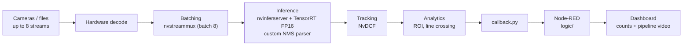
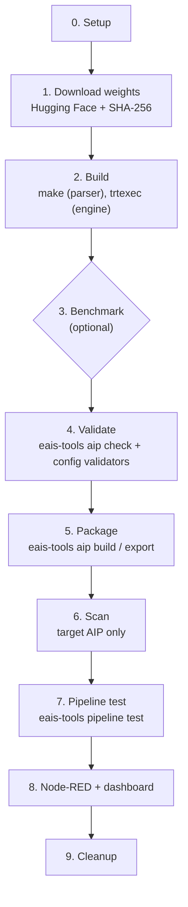

# AIPV1EMI0001 — YOLOv7 Tiny AiProcessor


An [EdgeAI Station](https://edgematrix.com) AiProcessor (AIP) detecting cars, people and trucks using a reparameterized [YOLOv7-tiny](https://github.com/WongKinYiu/yolov7) model, running on NVIDIA DeepStream with Triton Inference Server.

## What it does

Detects 3 generic object classes in video streams:

- `car`
- `person`
- `truck`

Tracking is handled by the NVIDIA NvDCF multi-object tracker. The AIP supports the `ROI` (region of interest) and `LCC` (line crossing counter) analytic plugins, and up to 8 input streams.

## Repository layout

| Path | Description |
|---|---|
| `manifest.json` | AIP descriptor (ID, version, hardware targets, processors, analytics) |
| `store.json` | EdgeAI Store listing metadata |
| `callback.py` | User callback — transforms DeepStream batch metadata into AIP metadata |
| `logic/` | Importable Node-RED project: callback subscription and count normalization |
| `dashboard/` | Offline Vue 3 UIBuilder SPA with pipeline-selected HLS/WebRTC video, class, ROI and line-crossing views |
| `configs/` | DeepStream inference config (`nvinferserver` / Triton) and NvDCF tracker config |
| `models/AIPV1EMI0001_Yolo_Detector/` | Triton model repository: `config.pbtxt`, labels. Model weights are **not** stored here — they are downloaded from Hugging Face (see below) |
| `src/nvdsinfer_customparser/` | Custom bounding-box parser plugin (`libnvds_infercustomparser.so`) for `nvinfer` |
| `bin/build.sh` | Builds the custom parser plugin and the TensorRT engine with `trtexec` |
| `localdev.ipynb` | Step-by-step build notebook: download weights → build → optional benchmark → validate → package → scan → pipeline test → dashboard |
| `accuracy.ipynb` | Labelled detection evaluation: compare FP32/FP16 and the deployment engine on COCO-format data |
| `presentation.ipynb` | Talk companion: AI Processor concepts, pipeline diagrams and benchmark results |
| `tools/` | Notebook and CI helpers: package checks, inference latency benchmarks and labelled accuracy evaluation |
| `doc/` | User manual and integration notes |
| `doc/benchmarks/` | Reference benchmark results (JSON) and chart |
| `tests/` | Offline tests for the notebook, tools and dashboard |
| `.github/workflows/release.yml` | CI: on `v*` tag, packages the AIP archive and publishes a GitHub release |

## Requirements

- EdgeAI Station (EX3 / EX5 / EX7 hardware targets) or a Jetson host (Jetson only — x86 NVIDIA GPU hosts are not supported) with:
  - DeepStream 7.0+
  - TensorRT (`trtexec`)
  - CUDA toolkit (to build the custom parser plugin)

The manifest lists EX3, EX5 and EX7 targets. The documented build and pipeline
checks have been exercised on an Orin NX 16 GB with JetPack 6.0 / L4T R36.3,
TensorRT 8.6.2 and DeepStream 7.0; the other targets have not been independently
verified. TensorRT engines are hardware- and runtime-specific.

## Model weights

The trained weights are not stored in this repository. They are published on Hugging Face at
[`Edgematrix-JP/AIPV1EMI0001`](https://huggingface.co/Edgematrix-JP/AIPV1EMI0001):

| File | Description |
|---|---|
| `yolov7tiny-640.onnx` | **Primary artifact** — ONNX export with `EfficientNMS_TRT`, input for the engine build |
| `yolov7-fp16-1x8x8-jp6-l4t36.3-arm64.engine` | Prebuilt TensorRT FP16 engine (JetPack 6 / L4T R36.3 / aarch64 only) |
| `SHA256SUMS` | Checksums for download verification |

The published weights declare **GPL-3.0** ([`LICENSE.weights`](LICENSE.weights)).
The trainer, dataset and complete checkpoint provenance have not been independently
documented.

The notebooks and release workflow download from a fixed Hugging Face revision and
verify each artifact's SHA-256 checksum.

## How it works



Frames stay in GPU memory from decode to analytics; only metadata reaches Python.
`nvinferserver` runs the Triton runtime **inside** the DeepStream process, with no network
hop to a separate model server.

### Callback output

The callback emits per-source frame counts or merge-window statistics. `available`
is `false` when a source has no frame in the window; its class statistics are `null`,
not zero. ROI and line-crossing statistics use only reported values; an unreported
label is omitted rather than assumed to be zero. `count_val` is the sum of per-frame
class counts, not a count of unique tracked objects. The dashboard displays
unavailable values as `N/A`; the latest metadata timestamp is not a freshness alarm.
See the [callback contract](doc/USER_MANUAL.md#callback-output-metadata-contract) for the full shape.

## Build, package & deploy

[`localdev.ipynb`](localdev.ipynb) rebuilds the AIP step by step. Each cell is one visible
command, mostly `eais-tools`, `trtexec` and `make`, or a short inline check. A failing
command stops the notebook.



On a fresh station, run it in the Jupyter environment (App-Builder) from a clone at
`/data/aip/AIPV1EMI0001`:

```bash
[ ! -e /data/aip/AIPV1EMI0001 ] || { echo "AIP directory already exists; coordinate the upgrade"; exit 1; }
cd /data/aip && git clone https://github.com/edge-ai/AIPV1EMI0001.git
```

The station watches `/data/aip`. Do not move, replace or remove an existing AIP
directory as a setup shortcut: coordinate upgrades with the station administrator.

Options:

- Step 0, `ENGINE_SOURCE = "build"` compiles the FP16 engine from the ONNX with `trtexec`.
  Allow 30–60 minutes on a busy Orin NX. `"prebuilt"` downloads the engine from Hugging Face
  instead (built and tested on the Orin NX stack above). The download checks the
  TensorRT version; the later engine-load smoke test checks this device.
- Step 0, `RUN_BENCHMARKS = True` enables section 3. It is off by default.
- Step 8, `NR_PROJECT`: use a new name on a station that already has the default Node-RED
  project. The cell refuses to overwrite an existing project unless `OVERWRITE=1`.

The pipeline test and dashboard are wired to a temporary `eais_*` pipeline. Step 9
deletes it only if cleanup is explicitly enabled. To keep the dashboard, select a
permanent pipeline in the callback node. Cleanup keeps `dist/` and the exported archive.

The build and pipeline portions of an earlier notebook revision were exercised with both
engine options on a Jetson Orin NX 16 GB
(JetPack 6.0 / L4T R36.3, TensorRT 8.6.2, DeepStream 7.0, `eais-tools` 0.9.2), with the
benchmark disabled. Activating and viewing the dashboard remains a manual step.

**Packaging safeguards.** EAIS Tools 0.9.2 does not honor `.gitignore` or `!` exclusion
rules, and copies whole directories. [`.include`](.include) therefore lists individual files,
and the notebook passes it explicitly to `eais-tools aip build`.
[`tools/check_package.py`](tools/check_package.py) then requires the exact intended file set
in `dist/`, and checks that the exported archive matches `dist/` file by file (SHA-256).
Unexpected files cause a failure, not silent removal.

**Configuration validation.** Step 4 runs `eais-tools aip check`, then calls the EAIS Triton
and DeepStream validators directly on the deployment configs, plus tracker YAML and library
path checks. (`eais-tools configs triton check` and `configs ds check` start a blocking
server, and the latter does not exercise `nvtracker`.)

**Targeted scan.** Step 6 asks ms3 to scan only this AIP with `force=false`, rather than
rescanning every processor. If this AIP is already registered with the separate ms7 model
server, the scan fails instead of force-unregistering it; coordinate with the station
administrator before changing that registration.

**Runtime acceptance.** Step 7 runs `eais-tools pipeline test` on the station-managed
pipeline (inference, NvDCF tracker and callback, display output disabled). It requires
detected objects and valid callback metadata, not merely a start response. Before testing
and cleanup, the notebook checks that no other run owns existing `eais_*` resources, since
`eais-tools pipeline clean` deletes all of them.

### Comparable ONNX/TensorRT measurements

Section 3 of the notebook runs [`tools/benchmark.py`](tools/benchmark.py). It compares direct
ONNX Runtime CUDA FP32 inference with TensorRT FP32 (`--noTF32`) and FP16 engines **using one
timing boundary for every backend**.

[NVIDIA's timing definitions](https://docs.nvidia.com/deeplearning/tensorrt/archives/tensorrt-861/developer-guide/index.html#trtexec)
show why `trtexec` cannot simply be placed next to a Python ONNX Runtime loop: its GPU
Compute Time excludes host dispatch, its Host Latency sums transfer and GPU times, and it
pipelines submissions. The harness therefore follows Ultralytics's normal prediction path:
[its inference-only timing block](https://github.com/ultralytics/ultralytics/blob/80c34c050921abd29970d8e3d2a2a41ec6538c98/ultralytics/engine/predictor.py#L380-L397)
uses [the same synchronized wall-clock profiler](https://github.com/ultralytics/ultralytics/blob/80c34c050921abd29970d8e3d2a2a41ec6538c98/ultralytics/utils/ops.py#L20-L76)
around each backend. (Its separate
[`ProfileModels.profile_onnx_model`](https://github.com/ultralytics/ultralytics/blob/80c34c050921abd29970d8e3d2a2a41ec6538c98/ultralytics/utils/benchmarks.py#L512-L585)
runs ONNX on CPU, so it is not a GPU-to-GPU reference.)

In one Python process:

- All variants run the same NMS-free graph. The deployment graph keeps NMS.
- ONNX Runtime is configured to prefer `CUDAExecutionProvider` with `use_tf32=0`, matching
  the engines' `--noTF32`; TensorRT FP16 is built with `--fp16 --noTF32`. ONNX Runtime may
  still assign nodes to its CPU provider.
- `trtexec` only builds the engines. The **actual `.engine` files** are executed by
  TensorRT's Python runtime (`execute_async_v3`). ONNX Runtime's TensorRT provider is not
  used: it would build its own engine instead of measuring the supplied one.
- All variants read the same GPU input buffer and write preallocated GPU outputs.
- Per request: `cudaDeviceSynchronize` → `perf_counter_ns` → one call →
  `cudaDeviceSynchronize`. 20 warm-up and 50 timed requests per round, 3 rounds, with
  backend order shuffled each round.
- Before timing, the same ONNX Runtime session runs an **untimed profile** at each batch size.
  The report counts unique executed nodes by provider and operator; profiling is stopped before
  measurements. `disable_fallback()` alone does not prevent CPU graph partitioning.
- Results: median, p95 and mean latency, ms/image, serial images/s and speed-up versus
  ONNX Runtime at the same batch. Outputs are compared after timing. GPU load, frequency and
  temperature are recorded around each round when available; clocks and power mode are not changed.

An MS8 image can have the TensorRT libraries without Python bindings. If they are not already
importable, the harness downloads `python3-libnvinfer` at exactly the installed `libnvinfer8`
version from the configured NVIDIA Jetson APT repository, checks its hash and exact dependencies,
and extracts it under `tmp/`; nothing is installed system-wide. A current PyPI `tensorrt` wheel
would not match the station. The reference run used a previously extracted, checksum-verified
matching package. The notebook keeps its models, logs and results under
`tmp/inference-benchmark/`, outside the AIP package. The benchmark does not use a model server
or restart station services.

Reference run (Orin NX 16 GB, L4T R36.3, TensorRT 8.6.2, ONNX Runtime 1.19.0; median
per-request latency, speed-up versus ONNX Runtime). Full results:
[`doc/benchmarks/orin-nx-16gb-jp6.0.json`](doc/benchmarks/orin-nx-16gb-jp6.0.json),
chart: [`doc/benchmarks/orin-nx-16gb-jp6.0.png`](doc/benchmarks/orin-nx-16gb-jp6.0.png).

| Batch | ONNX Runtime CUDA FP32 | TensorRT FP32 | TensorRT FP16 |
|---|---|---|---|
| 1 | 22.3 ms | 16.6 ms (1.34×) | 4.7 ms (4.76×) |
| 4 | 81.5 ms | 56.1 ms (1.45×) | 14.6 ms (5.58×) |
| 8 | 139.2 ms | 108.0 ms (1.29×) | 27.1 ms (5.13×) |

All station video pipelines were stopped for this run; other services were left running.
Before the benchmark, GPU load was 0% over ten samples and temperature was 79.5–79.9 °C.
During the measured rounds, sampled GPU frequency was 918 MHz and temperature was
83.3–88.8 °C. These are sample points, not proof of an otherwise idle device; re-run for
your own station. To isolate runtime contention, this run reused the exact graph and benchmark
engines from the previous reference; it did not rebuild the engines under idle conditions. The
benchmark does not stop pipelines itself.

The ONNX Runtime profile observed **173 CUDA nodes and 9 CPU nodes** across batches 1, 4
and 8. The CPU nodes were small `Gather`, `Unsqueeze` and `Concat` operations on integer
shape tensors. Their execution and transfers are included in ONNX Runtime latency: this is
a mixed-provider comparison, not a pure GPU-kernel comparison. TensorRT FP32 matched ONNX
Runtime closely (max raw score difference ≈ 3×10⁻⁷). FP16 raw scores differed by at most
4.2×10⁻⁴; some raw box coordinates moved by up to 14 px. The input is random, so this is
a numerical sanity check, not an accuracy evaluation.

### Labelled accuracy validation

[`accuracy.ipynb`](accuracy.ipynb) complements the latency benchmark with a step-by-step
evaluation of **labelled detections**. It compares ONNX Runtime FP32, TensorRT FP32 and
TensorRT FP16 on the same COCO-format images and at batches 1, 4 and 8. The notebook can
download COCO val2017 or use another dataset with `car`, `person` and `truck` categories.
It can reuse the raw benchmark engines, or build them with the same profile and flags.

The raw models share the same RGB resize, padding and low-threshold, class-aware
postprocessing. [`tools/accuracy.py`](tools/accuracy.py) reports COCO mAP@0.50:0.95 and
AP@0.50, per-class AP, and precision/recall at confidence 0.35 and IoU 0.50. It also
compares FP16 against TensorRT FP32 with adjustable, provisional parity tolerances:
at most 0.5 percentage points less mAP and 1 percentage point less recall for each class.
These are relative checks, **not** evidence that the FP32 baseline is accurate enough.

The actual deployment engine has embedded NMS with a 0.35 score threshold: its direct
precision/recall are reported separately, while standard mAP is omitted because low-score
detections have already been discarded. OpenCV preprocessing and NMS are not proven
identical to DeepStream preprocessing or the TensorRT plugin. Direct engine evaluation
does not exercise the DeepStream parser, tracking or callback.

**Reference evaluation.** The same Orin NX / JetPack 6 stack evaluated all 5,000 COCO
val2017 images with video pipelines stopped. The raw-model results below use the shared
postprocessing described above; each batch is shown separately, rounded to two decimals.
The [aggregate report](doc/benchmarks/orin-nx-16gb-jp6.0-accuracy.json) records the data
fingerprints, engine hashes, method, all class metrics and parity comparisons. It contains
neither dataset images nor per-image predictions.

| Variant | mAP 50:95, batch 1 | batch 4 | batch 8 | AP 50, batch 1 |
|---|---:|---:|---:|---:|
| ONNX Runtime FP32 | 12.64% | 12.64% | 12.64% | 23.28% |
| TensorRT FP32 | 12.64% | 12.64% | 12.64% | 23.28% |
| TensorRT FP16 | 12.64% | 12.64% | 12.64% | 23.26% |

The direct deployment engine produced these operating-point results at confidence ≥ 0.35
and matching IoU ≥ 0.50 (batch 1; batches 4 and 8 round to the same values):

| Class | Labelled objects | Precision | Recall |
|---|---:|---:|---:|
| car | 1,918 | 35.65% | 41.66% |
| person | 10,777 | 66.27% | 23.96% |
| truck | 414 | 22.58% | 15.22% |

FP16 passed the provisional parity checks against TensorRT FP32 at all three batches,
but **parity is not quality**: the absolute recalls above are low, especially for trucks.
Investigate the model, preprocessing and confidence threshold, and evaluate the intended
camera conditions before deciding whether the detector is suitable.

For rollout, evaluate labelled, permission-cleared target-camera data and the complete
pipeline as well. The notebook can score a separately captured per-frame detection file;
the existing callback emits aggregated counts, not the boxes needed for that capture.
Frame alignment, capture completeness, tracking and event/count accuracy require separate
validation. The original model's training dataset and exact checkpoint are undocumented, so
overlap with COCO validation cannot be ruled out. The accuracy notebook does not stop pipelines
or change station services.

For CPU-only regression tests, install [`tests/requirements-accuracy.txt`](tests/requirements-accuracy.txt)
in a virtual environment and run `python3 -m unittest discover -s tests`. These tests do not
replace a TensorRT or DeepStream run on the target station.

### Release CI

The tag-triggered release workflow compiles the ARM64 parser in a pinned public DeepStream
7.0 SDK image, adds the checksum-verified prebuilt engine, and exports an archive with a
`dist/` root, matching `eais-tools aip export`. This image lacks EAIS Tools, so CI assembles
`dist/` from the explicit `.include` files and checks the result and the archive with the
same `tools/check_package.py`. The notebook remains the workflow that runs EAIS
validation, build and export. A manual workflow run validates packaging and saves an Actions
artifact without publishing a release.

## Presentation notebook

[`presentation.ipynb`](presentation.ipynb) is the companion to the talk *From Model to Field:
Engineering Reliable Edge AI Applications on Embedded GPUs*. It explains the AI Processor
contract, the GPU pipeline, the ONNX-to-TensorRT path, fair measurement, reproducible
packaging and layered validation, with diagrams and the benchmark chart above. Its live cells
are disabled by default. The separate [`accuracy.ipynb`](accuracy.ipynb) provides the
hands-on labelled evaluation.

## Integrated Node-RED dashboard

The AIP package includes a Node-RED project under [`logic/`](logic/) and its
UIBuilder application under [`dashboard/`](dashboard/). Together they provide:

- live video using HLS or WebRTC automatically from the pipeline's output
  settings, matching the station web UI without a transport selector;
- per-class counts for `car`, `person`, and `truck`;
- per-source filtering;
- ROI and line-crossing counters when those analytics are configured.

The Node-RED runtime must load `@edgematrix/node-red-contrib-eais` **0.7.10**
and UIBuilder. The separate local integration-test harness uses Node-RED 4.1.13
and Node.js 22; it does not upgrade the station runtime.
Some stations instead have the legacy
`@edge-ai/node-red-contrib-eais`; the two EAIS variants must **not** coexist
because they register the same node types. Arrange any migration and restart
with the station administrator; see [`logic/README.md`](logic/README.md).

Step 8 of [`localdev.ipynb`](localdev.ipynb) prepares the project
`nodered-aipv1emi0001-dashboard`, preselecting its test pipeline. It installs
the dashboard's browser dependencies, not the Node-RED runtime nodes. To
install it by hand, copy `logic/` to a new Node-RED project, copy the contents
of `dashboard/` into that project's `uibuilder/` directory and run
`npm ci --omit=dev` there. Open the project, select the pipeline in the
**AIPV1EMI0001 callback** node, and deploy. Open the dashboard at
`https://<station>/ms5/aipv1emi0001_dash/` and assign `aipv1emi0001_dash` to
users from Accounts management.

`flows_cred.json` is deliberately not distributed. If the project needs
credentials, configure Node-RED's `credentialSecret` through the station's
deployment environment, then let Node-RED generate the local credential file.
Never commit or redistribute that file.

The callback payload itself remains the source contract. Enable the flow's
disabled **inspect complete callback msg** debug node after MS3 or callback-node
upgrades and compare the live message with [`doc/USER_MANUAL.md`](doc/USER_MANUAL.md).

## Attribution

The model architecture is **YOLOv7** by WongKinYiu et al.:

> Chien-Yao Wang, Alexey Bochkovskiy, Hong-Yuan Mark Liao.
> *"YOLOv7: Trainable bag-of-freebies sets new state-of-the-art for real-time object detectors."*
> CVPR 2023. <https://github.com/WongKinYiu/yolov7> — GPL-3.0 License.

This YOLOv7-tiny integration was adapted by EdgeMatrix for EdgeAI Station and exposes
`car`, `person` and `truck`. The trainer, training dataset, intended training domain and
complete checkpoint provenance of the published export remain unverified.

## Contributors

This AI Processor was originally developed at EdgeMatrix by:

- [@antowan](https://github.com/antowan)
- [@aohta-emi](https://github.com/aohta-emi)
- [@yosukehara](https://github.com/yosukehara)

## License

- **Source code** in this repository: Apache-2.0 — see [LICENSE](LICENSE). It contains no
  YOLOv7 source code.
- **Model weights** (ONNX and TensorRT engines on Hugging Face, and the engine inside the packaged
  AIP): GPL-3.0, because they were trained with the
  [GPL-3.0 YOLOv7 code](https://github.com/WongKinYiu/yolov7/blob/main/LICENSE.md).
  `manifest.json` therefore declares `Apache-2.0 AND GPL-3.0-only`.
  The packaged weights' licence text is included as [LICENSE.weights](LICENSE.weights).

Third-party files keep their own MIT licence notices:
[`src/nvdsinfer_customparser/`](src/nvdsinfer_customparser/) and
[`configs/config_tracker_NvDCF_perf.yml`](configs/config_tracker_NvDCF_perf.yml), both from NVIDIA.
