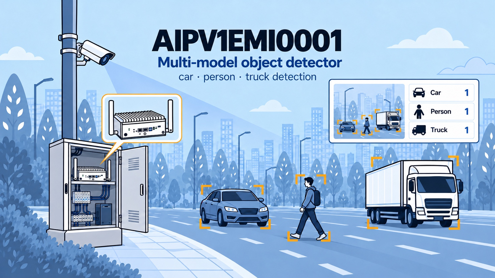

# Building AI Processors for the EdgeAI Station

Learn how to build and deploy an **AI Processor (AIP)** on the [EdgeAI Station](https://edgematrix.com). This training uses `AIPV1EMI0001`, a working object-detection application, to demonstrate model integration, business logic and a dashboard. You choose the YOLO model that fits your application and licensing requirements.



## What is an AI Processor?

An AI Processor is a deployable application package for the EdgeAI Station, not just a model file. It brings together three layers:

| Layer | Role |
|---|---|
| **AI models** | Perform primary inference, or combine primary and secondary inference, such as object detection followed by classification. Model configuration and a Python callback turn inference results into application data. |
| **Business logic** | Node-RED flows use the [EdgeAI Station Node-RED library](https://www.npmjs.com/package/@edgematrix/node-red-contrib-eais) to consume inference data, apply application rules and interact with station services. |
| **Dashboard** | A web interface presents results and application controls. [UIBuilder](https://github.com/TotallyInformation/node-red-contrib-uibuilder), a third-party open-source Node-RED project, connects the interface to the flows. |

The station provides the video-pipeline runtime. An AIP supplies the models, configuration and application components needed for its use case; a dashboard can be included when a user interface is needed.

## What this training covers

The example detects and tracks **cars, people and trucks** in camera feeds or video files using **one primary YOLO detector**. NVIDIA DeepStream decodes the video, runs the selected TensorRT engine through Triton, and tracks detections. The shared [callback](callback.py) reports object counts and configured region-of-interest and line-crossing analytics.

The build notebooks focus on exporting official pretrained weights to ONNX, building a TensorRT engine, configuring inference and its parser, then packaging and testing the AIP. The comparison notebook shows how to assess accuracy, inference time and camera capacity. No model training is required.

The included [Node-RED business logic](logic/) normalizes callback data for the [UIBuilder dashboard](dashboard/), which displays video and counts by camera. These provide a working integration; [dashboard setup](doc/USER_MANUAL.md#node-red-dashboard) is separate from the model build lessons. Secondary-inference chains, custom model training, and comprehensive business-logic or dashboard authoring are not covered by these notebooks.

## Choose a model

The supported build recipes are [YOLOv7-tiny](notebooks/01-build-yolov7.ipynb), [YOLOv10n](notebooks/02-build-yolov10.ipynb) and [YOLO26n](notebooks/03-build-yolo26.ipynb). Choose according to your application, accuracy and latency targets, hardware constraints and deployment requirements. [Measured results](#measured-results) show accuracy, inference time and camera capacity on the EX5 and EX3.

**Review the selected model's license before building or deploying it.** Model code and pretrained weights have licensing terms separate from this repository's application code. Check that those terms match your intended use and distribution requirements; see [Licenses](#licenses).

**This example builds one AIP with one primary detector.** The folders under [`flavors/`](flavors/) are build recipes, not separate AIPs. Changing the flavor replaces the detector without changing the `AIPV1EMI0001` ID, business logic or dashboard. The build copies the selected model's settings into `configs/` and `models/`, where the station expects them. See [model selection and package details](doc/USER_MANUAL.md#where-model-settings-live).

## Get started

**New to the station?** [Follow one frame from camera to count](notebooks/00-presentation.ipynb). This introduction needs no hardware.

**To build**, open an App-Builder (Jupyter) terminal on a development station. The reference stack is JetPack 6.0, TensorRT 8.6 and DeepStream 7.0. If the project isn't already installed:

```bash
cd /data/aip && git clone https://github.com/edge-ai/AIPV1EMI0001.git
```

Open the build notebook for your chosen model under `AIPV1EMI0001/notebooks/`. It takes you from pretrained weights to an installable package, then tests it on sample video. Don't build over an AIP that is already in use.

**To install a package or connect the dashboard**, see the [user manual](doc/USER_MANUAL.md).

## Measured results

Use these measurements as one input to model selection, then evaluate on your own hardware and scenes. Results cover two stations: the **EX5** (Jetson Orin NX 16 GB) and the **EX3** (Jetson Orin Nano 8 GB).

| Model and build notebook | mAP 50:95, 80 COCO classes (published) | mAP 50:95, car / person / truck | FP16 ms per image (EX5, batch 1) | EX5 cameras, no output | EX3 cameras, no output |
|---|---:|---:|---:|---:|---:|
| [YOLOv7-tiny](notebooks/01-build-yolov7.ipynb) | 37.13 (n/a) | 39.41 | 8.4 | 4 | 3 |
| [YOLOv10n](notebooks/02-build-yolov10.ipynb) | 38.34 (38.5) | 40.54 | 5.5 | 6 | 5 |
| [YOLO26n](notebooks/03-build-yolo26.ipynb) | 39.92 (40.1) | 40.67 | 5.3 | 7 | 5† |

**Accuracy and inference time** were measured on the EX5 (JetPack 6.0, TensorRT 8.6, FP16 engines) from 17 to 19 November 2026. Accuracy uses all 5,000 COCO val2017 images; the authors' published score is in brackets. Inference time is for one image on an idle GPU, without decoding or tracking.

**Reading batch results:** batch size is the number of images in one inference request, not a camera count. The [comparison lesson](notebooks/04-compare-models.ipynb) explains how to read per-image and whole-request times, and what the results mean for a one-camera pipeline.

**Camera counts** are 720p30 H.264 cameras per pipeline with video output off. A count passed when every camera averaged at least **29 processed FPS** over 120 seconds. The EX5 ran in MAXN power mode on 18 and 19 November 2026; 1080p cameras gave the same counts. The EX3 ran in 15 W mode with JetPack 6.0 on 25 and 26 November 2026; 1080p cameras were not tested.

The EX3 and EX5 tests used different input scenes, so their camera counts are station-specific results, not a controlled, scene-identical hardware comparison.

**With video output**, both stations were tested with the same checks for WebRTC streaming, Smart Video event recording, and both together:

- **EX5:** all nine one-camera model/profile checks passed. Its multi-camera output limits have not been established.
- **EX3:** with one camera, detection stayed near 30 FPS for every model, but the delivered video failed frame-rate and/or continuity requirements, so no output profile qualified. See the [EX3 report](doc/benchmarks/orin-nano-8gb-jp6.0/capacity.md) for details.

At six cameras, YOLO26n passed 3 of 7 EX3 attempts; five cameras passed in both runs.

The [comparison notebook](notebooks/04-compare-models.ipynb) explains these results. Device reports give the details for the [EX5](doc/benchmarks/orin-nx-16gb-jp6.0/capacity.md) and the [EX3](doc/benchmarks/orin-nano-8gb-jp6.0/capacity.md); the [EX3/EX5 matrix](doc/benchmarks/capacity/README.md) compares them side by side.

## Prebuilt TensorRT engines

Three SHA-256-verified **v7.0.0** engines are available from the [Hugging Face model repository](https://huggingface.co/Edgematrix-JP/AIPV1EMI0001/tree/ae3bd8c672013b3bb04a9af262130dcbaa41a109/orin-nx-16gb-jp6.0). These exact binaries were used in the EX5 camera-capacity tests. They target a Jetson Orin NX 16 GB with JetPack 6.0 / TensorRT 8.6; rebuild for a different GPU or TensorRT version.

| Model | Download | SHA-256 |
|---|---|---|
| YOLOv7-tiny | [TensorRT engine](https://huggingface.co/Edgematrix-JP/AIPV1EMI0001/resolve/ae3bd8c672013b3bb04a9af262130dcbaa41a109/orin-nx-16gb-jp6.0/yolov7-fp16-1x8x8.engine) | `c9da0f95ec3f10cc2d5cd213dbfc364a932478a4e884b1d873cf69919842fa5c` |
| YOLOv10n | [TensorRT engine](https://huggingface.co/Edgematrix-JP/AIPV1EMI0001/resolve/ae3bd8c672013b3bb04a9af262130dcbaa41a109/orin-nx-16gb-jp6.0/yolov10-fp16-1x8x8.engine) | `8add86b6a31ec672381cf5b23d56f62c8cfcb0f30812d1591d039cc67300c85f` |
| YOLO26n | [TensorRT engine](https://huggingface.co/Edgematrix-JP/AIPV1EMI0001/resolve/ae3bd8c672013b3bb04a9af262130dcbaa41a109/orin-nx-16gb-jp6.0/yolo26-fp16-1x8x8.engine) | `0cb26f248c60759893471f9966d293b62faa812a7d98bd69183d0c99a7f96802` |

The [user manual](doc/USER_MANUAL.md#tensorrt-engine-files) covers engine compatibility and release artifacts.

## Licenses

The [source code](LICENSE) is Apache-2.0, with NVIDIA components retaining their MIT notices. The model weights have separate terms: [GPL-3.0](licenses/GPL-3.0.txt) for YOLOv7-tiny; [AGPL-3.0](licenses/AGPL-3.0.txt) for YOLOv10n and YOLO26n. The application-code license does not replace the selected model's terms. Review the upstream model licenses and any applicable license agreements for your deployment. See [project and model credits](doc/README.md#credits).
